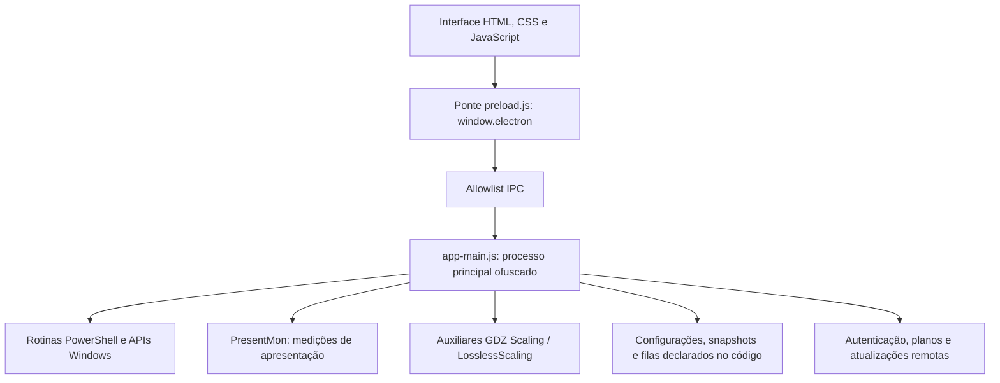

# Engenharia reversa estática do GDZ Optimizer 1.1.27

Análise realizada em 08/11/2026 sobre a instalação existente neste computador. O repositório solicitado foi clonado; o aplicativo real foi localizado e inspecionado por arquivos, sem aplicar seus ajustes. Esta entrega mapeia arquitetura, interface, comunicação e mecanismos visíveis. Não equivale à recuperação integral do código original nem a uma validação funcional de todas as rotinas.

**Aprofundamento posterior:** o [mapa completo de funções](GDZ-MAPA-COMPLETO.md) acrescenta recuperação estática do backend, explicações individuais e contratos IPC. A contagem lexical de 175 citada nesta primeira etapa inclui 16 funções PowerShell em strings; o inventário AST posterior distingue 159 declarações JavaScript e 70 expressões de função nomeadas.

## Resultado verificável

| Item | Resultado |
| --- | --- |
| Repositório solicitado | `.tools/Reverse-Engineering-ChatGPT`, commit `05f9443b32055397c5debbab348921c3595a6c7c` |
| Conteúdo do repositório | README, licença MIT, `.gitignore` e dois arquivos de prompts; sem instalador, dependências ou analisador de executáveis |
| Programa analisado | `%LOCALAPPDATA%\Programs\GDZ Optimizer\GDZ Optimizer.exe`, versão de produto `1.1.27.0` |
| Tecnologia principal | Electron; pacote `gdz-optimizer` 1.1.27, entrada `app-main.js`, ponte `preload.js`, interface HTML/CSS/JavaScript |
| Arquivo ASAR | 6.345.087 bytes; 752 arquivos e 95 diretórios |
| Inventário | 306 arquivos empacotados, 446 arquivos externos declarados no ASAR |
| Extração privada | 286 textos UTF-8, dos quais 38 pertencem ao app fora de `node_modules`; total de 4.981.595 bytes |
| Integridade | SHA-256 calculado dos 306 arquivos empacotados; todos coincidiram com seus hashes declarados no pacote |
| Ponte de interface | 9 canais `send`, 87 canais `invoke`, 4 eventos recebidos |
| Catálogo de interface | 78 entradas declaradas; inclui ajustes, verificações, ferramentas e dicas |
| Validação da ferramenta | 22 verificações aprovadas, além da execução do wrapper e conferência independente dos 286 textos |

O [repositório de xianminx](https://github.com/xianminx/Reverse-Engineering-ChatGPT) reúne textos sobre prompts. Ele não disponibiliza o mecanismo usado nesta inspeção. A clonagem atende à solicitação de disponibilizá-lo localmente; não existe uma aplicação nesse repositório para instalar ou iniciar. Os textos externos foram tratados como dados de terceiros, sem seguir instruções contidas neles.

## Arquitetura recuperada



As setas representam relações encontradas nos arquivos, não chamadas executadas nesta análise. Foram lidos o pacote instalado e seus auxiliares; não foi necessário iniciar outra instância ou controlar a instância já aberta.

`package.json` declara `electron-updater: ^6.8.9`. O aplicativo distribui a maior parte da interface como texto legível; `app-main.js` tem aproximadamente 2,38 MB, identificadores alterados, tabela de strings e expressões de ofuscação. Permanecem legíveis declarações de funções e vários scripts PowerShell multilinha. A varredura lexical reconheceu 175 declarações de funções com nomes legíveis, sem interpretar seu JavaScript.

Em dois trechos de configuração de janela aparecem `nodeIntegration: false`, `contextIsolation: true` e `sandbox: false`. O preload expõe um objeto `window.electron` com listas explícitas de canais e filtra links externos por HTTP(S). Isso descreve o conteúdo inspecionado; não constitui auditoria de segurança de todos os handlers.

O comentário do próprio pacote afirma haver proteções de fuses/integridade. Esse comentário é uma alegação do distribuidor: as configurações completas dessas proteções não foram verificadas, desativadas ou modificadas. A leitura estática de ASAR é suficiente para examinar os textos disponíveis; o [formato é descrito pelo Electron](https://www.electronjs.org/docs/latest/tutorial/asar-archives) e sua [implementação oficial](https://github.com/electron/asar/blob/main/src/disk.ts) foi consultada para conferir os offsets.

## Interface e contagens

A captura fornecida mostra o painel inicial com busca, categorias, hardware, recomendações e o indicador “14 de 19 aplicados”, acompanhado de cinco pendências. Esses números são estados exibidos naquela captura, não uma medida de desempenho e nem o tamanho do catálogo completo.

A análise de `src/otimizacoes.js` identifica 78 entradas: 33 tweaks, 18 ações reversíveis, 5 ações pontuais, 5 verificações, 5 ferramentas, 4 reparos, 7 dicas e 1 opção de DNS. Isso corresponde a até 51 controles de alternância antes dos filtros de hardware/capacidade. O painel calcula seu subconjunto de recomendações com filtros; o botão de otimização rápida chama uma ação própria do backend. Não se deve inferir que o botão percorra todas as 78 entradas ou todas as recomendações da interface.

O mapa detalhado, a lista dos canais e as referências de linhas ficam em [GDZ-FRONTEND.md](GDZ-FRONTEND.md).

## Mecanismos Windows visíveis

As linhas abaixo referem-se ao arquivo `app-main.js` extraído, conservando as quebras originais. Alguns limites de função estão em linhas muito longas; o número de linha serve para localização, não indica que o trecho inteiro seja legível.

| Subsistema | Evidência estática | O que permite concluir |
| --- | --- | --- |
| Capacidades | Linhas 3–40: CIM de CPU/GPU, build do Windows, bateria, Steam, OBS e propriedades de adaptadores de rede | Há detecção contextual; não é apenas uma lista fixa baseada na captura |
| Verificações | Linhas 69–124: referências a CPU/CCD, Game Bar, plano equilibrado, microcódigo, Modo de Jogo, HAGS e NVIDIA | Existem verificações específicas de configuração e hardware; seus resultados não foram executados |
| Medição de gargalo | Linhas 126–159: amostragem aproximadamente por segundo, janela em primeiro plano, CPU total e maior núcleo, engines GPU 3D e RAM | O coletor considera carga observada e foco do jogo; os limiares finais de classificação não foram integralmente recuperados |
| Jogos | Linhas 170–244: bibliotecas Steam, manifests, executáveis e outras instalações | Existe descoberta de jogos por arquivos e processos, além dos cartões com capas |
| Limpeza | Linhas 245–255: enumeração de alvos e remoção recursiva; linhas 666–682: caches Chromium, processos abertos, idade e Lixeira | Há rotinas potencialmente destrutivas reais no pacote; os alvos completos e todas as proteções não foram validados |
| Estado de ajustes | Linhas 257–267 e funções `detectActions`, `tweakStates`, `actionStates` | Parte do estado é obtida por leitura de configuração, como plano de energia e propriedades do Registro |
| NVIDIA | Região 269–369: funções DRS/NVAPI e código nativo incorporado em scripts | Há integração de perfis de driver no código; compatibilidade prática não foi testada |
| Ponto de restauração | Linhas 376–387: altera temporariamente frequência de criação, solicita checkpoint e tenta repor valor anterior | A rotina está presente; sua execução e sucesso neste PC não foram verificados |
| Snapshots | Linhas 389–451: captura Registro, serviços, plano, parâmetros AC, BCD, TCP, DNS e perfis DRS | O esquema de backup é mais amplo que apenas alternar indicadores na interface |
| Restauração | Linhas 452–504: Registro, `sc.exe`, `powercfg`, `bcdedit`, `netsh`, DNS e DRS | Há implementação de restauração; isso não demonstra recuperação completa, detecção de conflitos ou sucesso em qualquer Windows |
| Programas | Linhas 684–698: chaves Uninstall HKLM/HKCU, dados de MSI, comando de desinstalação e campos de versão/publicador | O inventário consulta instalações reais do Windows |
| Informações do PC | Linhas 706–824: CPU/cache, placa-mãe/BIOS/TPM, RAM, GPU, discos, monitores, bateria | O painel possui uma fonte técnica para inventário detalhado; precisão de todos os campos não foi medida |
| Dados ao vivo | Linhas 825–842: worker com prioridade baixa, CPU/GPU/VRAM, temperaturas disponíveis e intervalo de 1500 ms | Há coleta periódica no código; zona térmica não deve ser presumida como temperatura de CPU |
| FPS e overlay | Funções `fpsStart`, `fpsHandleLine`, `fpsStats`, `fpsMarkBase`, `overlayOpen` e auxiliar PresentMon | A infraestrutura de medição existe; precisão, overhead e comparações reais permanecem sem teste |

Na coleta de gargalo, o script deixa de acumular tempo útil quando o PID selecionado não está em primeiro plano e encerra se o processo fechar. Há um limite de tempo de parede de quatro vezes a duração solicitada. CPU, GPU e RAM, isoladamente, não comprovam a causa de um gargalo; não se recuperaram nem validaram integralmente os critérios que transformam amostras em diagnóstico.

O snapshot PowerShell preserva a existência e o tipo de valores do Registro, inclusive Binary, QWord e MultiString. O trecho de energia observado captura o índice AC; não há motivo para presumir que isso também capture todos os parâmetros DC. Alguns erros são tratados com `SilentlyContinue`; a inspeção não estabelece uma garantia global de verificação posterior ou reversão sem perdas.

## Auxiliares e origem técnica

Os arquivos `GDZOptimizer.exe` e `GDZOptimizer_original.exe` encontrados dentro de `app.asar.unpacked/bin` são auxiliares diferentes do executável principal com espaço no nome. Os metadados desses auxiliares indicam **GDZ Scaling 3.2.2**. Eles são apphosts nativos x64 apontando para `LosslessScaling.dll`; a DLL gerenciada identifica o assembly **LosslessScaling 3.2.2.0**, com WPF e runtime .NET 9. O pacote também contém `Lossless.dll`, `LosslessScaling.exe` e bibliotecas de suporte.

A comparação das seções PE observou código/seções de dados iguais entre três launchers e diferenças nos recursos. Isso permite identificar a relação entre os arquivos distribuídos, mas não estabelece autoria, autorização de distribuição ou equivalência com qualquer distribuição externa não examinada.

O `PresentMon.exe` distribuído anuncia versão 2.5.1 em seu texto de ajuda interno e tem assinatura Intel válida nesta máquina. Foram observadas referências ETW. O executável principal GDZ e os auxiliares de scaling listados no resumo retornaram `NotSigned`. Esses são resultados de inspeção dos arquivos locais, não uma classificação de confiança do produto.

Detalhes de PE, imports, metadados, hashes e limitações estão em [GDZ-AUXILIARES.md](GDZ-AUXILIARES.md).

## Rede e persistência

`resources/app-update.yml` declara um provedor genérico em `https://api.gdzfps.com/api/v1/updates`. Esse endereço foi apenas lido no arquivo; não houve contato com ele. Os canais e os nomes de funções mostram autenticação, sessão, planos, consentimento e fila de telemetria, além de configurações e backups. Presença de código de telemetria não prova que uma transmissão ocorreu.

Não se leu `%APPDATA%\gdz-optimizer`, nem cookies, tokens, sessões ou credenciais. Não se testou autenticação, acesso comercial ou serviços remotos. Os caminhos persistentes e formatos completos que dependem da resolução das strings ofuscadas não foram integralmente reconstruídos.

## Ferramentas entregues e reprodução

Foram escritos dois arquivos originais no projeto:

- [scripts/inspect-asar.py](../scripts/inspect-asar.py): leitor ASAR em Python padrão, manifesto SHA-256 e extração opcional de texto. Valida formato, limites, nomes Windows, ranges, colisões, links e ancestrais com reparse points; recusa sobrescrita. Não lê os arquivos externos `unpacked`, apenas os lista.
- [scripts/analyze-gdz.ps1](../scripts/analyze-gdz.ps1): executa o leitor acima, inventaria o preload e nomes de funções, lê versões/assinaturas/hashes dos auxiliares e produz um resumo JSON. Não importa o JavaScript, não chama os canais IPC e não inicia executáveis do programa.

Execução a partir de qualquer diretório:

```powershell
powershell -NoProfile -File '.\scripts\analyze-gdz.ps1'
```

Por padrão, cada execução cria uma pasta nova em `artifacts/private/gdz-analysis/run-*`. Para outra instalação:

```powershell
powershell -NoProfile -File '.\scripts\analyze-gdz.ps1' `
  -InstallDir 'C:\Caminho\GDZ Optimizer' `
  -OutputDir 'C:\Analises\gdz-execucao-nova'
```

Requisitos: Windows PowerShell e Python 3.10 ou superior. O wrapper também usa Git, quando disponível, apenas para identificar o commit do clone. O destino precisa ser novo; o leitor recusa criá-lo dentro da pasta de origem do ASAR. Não há dependências Python/npm para instalar. A biblioteca padrão no Windows não oferece um sandbox atômico contra substituição concorrente de pastas; use um diretório privado estável.

## Evidências desta execução

Os arquivos extraídos ficam em `artifacts/private`, já excluído pelo `.gitignore`. Não foram incorporados ao código ou às releases do VL Optimizer.

- [Resumo da execução](../artifacts/private/gdz-analysis/run-20261108T145350Z-1d3232ca/summary.json).
- [Manifesto e hashes](../artifacts/private/gdz-analysis/run-20261108T145350Z-1d3232ca/manifest.json).
- [Allowlist IPC](../artifacts/private/gdz-analysis/run-20261108T145350Z-1d3232ca/ipc.json).
- [Funções e indicadores lexicais](../artifacts/private/gdz-analysis/run-20261108T145350Z-1d3232ca/backend-functions.json).
- [22 verificações do leitor](../artifacts/private/gdz-analysis/inspect-asar-checks.json).

Identidade do ASAR analisado:

```text
SHA-256: d257ff54de64f8f4cce03c5354cffe29f2c011ec0f9c8f90e9291921ddabf8f1
```

O hash original foi conferido novamente depois da extração e da coleta: permaneceu igual. A sintaxe de ambos os scripts foi verificada e o wrapper foi executado com sucesso. Os 286 textos também tiveram seus hashes conferidos por uma leitura independente do manifesto. Os testes cobrem extração válida, manifesto sem extração, nomes inválidos, ADS, nomes reservados, colisões, links, truncamentos, limites, ranges sobrepostos, hash divergente, saída na origem, sobrescrita e junctions reais.

Esta análise não executou scripts de otimização, limpeza, reparo ou restauração. Não foram produzidos benchmarks, provas de ganho de FPS ou uma desofuscação integral do processo principal. A implementação existente do VL Optimizer em `src`, seus instaladores e suas releases foram preservados.
